Cloud Database TiDB Single Availability Zone Cluster Service
=====================================

> **Disclaimer:** This document may contain third-party product information, which is for reference only. alibaba cloud does not make any implied or other commitments regarding the performance, reliability, and operation of third-party products.

Overview
-----------------------

TiDB single-zone clusters are cloud databases that are deployed and optimized based on the Alibaba Cloud environment, provide OLTP scale and real-time HTAP capabilities, and are cloud-native, one-click capacity scaling, financial-level high availability, MySQL protocol compatibility, and big data ecology. This topic describes how to deploy a TiDB single-zone cluster service instance.

Permissions required by the RAM account
------------------------------

The TiDB single-zone cluster service needs to access and create resources such as ECS, ESS, SLB, VPC, and OSS. If you use a RAM account to create a service instance, you need to add the corresponding resource permissions to the RAM account before creating the service instance.

| Permission policy name | Comment |
| ----------------- | -------------- |
| AliyunECSFullAccess | Permissions to manage ECS instances |
| AliyunESSFullAccess | Permissions to manage the Elastic Scaling Service (ESS) |
| AliyunSLBFullAccess | Permissions to manage the Load Balancing Service (SLB) |
| AliyunVPCFullAccess | Permissions to manage a VPC |
| AliyunOSSFullAccess | Manage Object Storage Service (OSS) permissions |
| AliyunEIPFullAccess | Manage Elastic IP(EIP) permissions |

TiDB single-zone cluster service resource configuration
-------------------------------------

Before deploying a service instance, you need to prepare and configure related resources in advance to ensure that the service instance can be deployed successfully. the following table lists the minimum configurations of the basic and high service resources.
**Important** The system space can be adjusted according to the actual situation, but it cannot be less than 40GB.

| Configuration Items | Basic Edition | High Edition |
| --------------------------------------------------------- | ------------------------------------------------------------------ |
| Local SSD ECS instances | Three local SSD ECS instances with 8 vCPU 64 GiB | Three local SSD ECS instances with 16 vCPU 64 GiB |
| Compute ECS instances | 4 2 vCPU 4 GiB Compute ECS instances 2 4 vCPU 8 GiB Compute ECS instances | 3 4 vCPU 8 GiB Compute ECS instances 2 8 vCPU 16 GiB Compute ECS instances 1 2 vCPU 4 GiB Compute ECS instances |
| Advanced SLB Load Balancing | 1 | 1 |
| | 1 | 1 | 1 |
| System disk | 40 GB | 40 GB |

Deployment Process
-------------------------

**Deployment steps**

1. Click the deployment link to purchase the product and complete the deployment through the deployment link in the product details.

2. After the service instance is successfully deployed, access the TiDB database service through the SLB load balancer of the service deployment.

**Deployment parameters**

You can use the service deployment link published by the service provider in the computing nest to deploy Alibaba Cloud resources and software provided by the service provider. When you create a service instance, you need to configure the service instance information.
Detailed parameters and precautions that need to be configured for the TiDB single-zone cluster service.

* **Geography**

Please select the appropriate region based on the actual situation. The TiDB single-availability zone cluster service is currently applicable to any region.
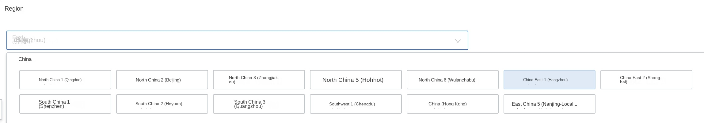

* **Payment Type**

Support pay-as-you-go and prepaid two payment modes, users can choose according to the actual situation.

* **Package selection**

TiDB single-zone cluster service currently supports two package types: basic version and high-configuration version, which correspond to different machine configurations and performance.
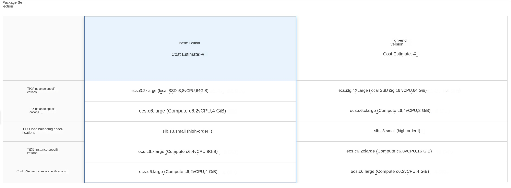

* **Topology Information**

The parameters in the topology information area are filled in by default. You can modify the default values according to your business needs.
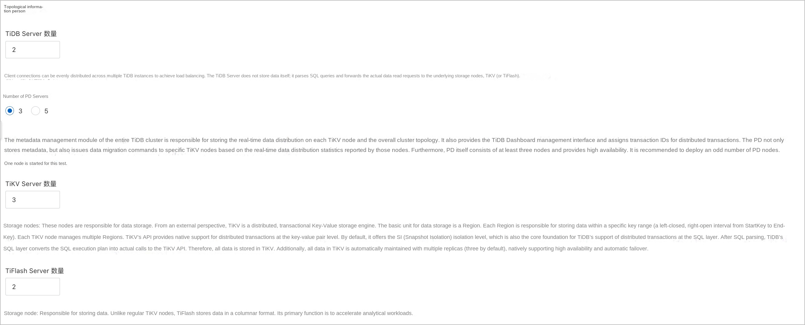

* **Basic resource configuration**

Set up VPC networks and switch resources in a single zone.
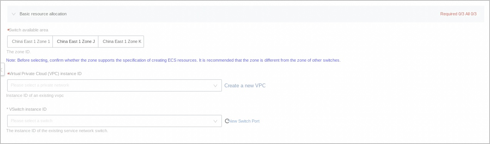

* **Cluster Information**

Set the system disk size and logon password.

The default value of the system disk is 40GB. Value range: 40\~ 500, unit: GB.

The login password, which is 8-30 characters in length and must contain three items (uppercase letters, lowercase letters, numbers, and special symbols in ()\'\~!@#$%\^\&\ *_-+ =\|{}\[\]:;' \<\>,.?/).
**Important** The logon password set here is the logon password of the ECS server, TiDB cluster service, and TiDB cluster monitoring Grafana after the service instance is deployed. Please keep it properly.

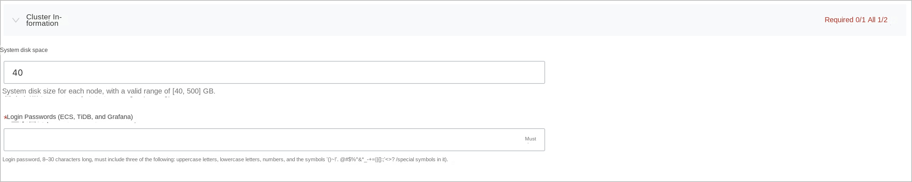

* **Tags and Resource Groups**

You can set tag attributes and resource group ownership for TiDB single-zone cluster services as needed.
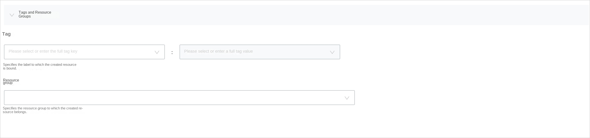

Log on to the TiDB cluster
-----------------------------

After the service instance is deployed, you can log on to the TiDB cluster of the service to view the instance resource information.

1. Log in to the Compute Nest Console (https://computenest.console.aliyun.com/#/vendor/cn-hangzhou/services).

2. In the left-side navigation pane, click **Service Instance Management**.

3. On the **Private Deployment Service** tab page, find the service instance you created.

4. Click the ID of the created service instance to enter the service instance details page.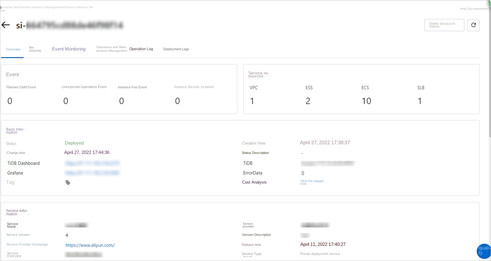

5. Click **Overview**. On the Overview tab page, view the TiDB cluster information.
* Click the IP address after **TiDB Dasboard** to enter the visual operation and maintenance monitoring page. After logging in, you can view the operation and maintenance monitoring information.

* Click the IP address after **Grafana** to go to the visual cluster performance monitoring page. After logging in, you can view the performance monitoring information.

On the Cluster Performance Monitoring page, click **TiDB-prod-Overview** to view the overview of the DB cluster instance.
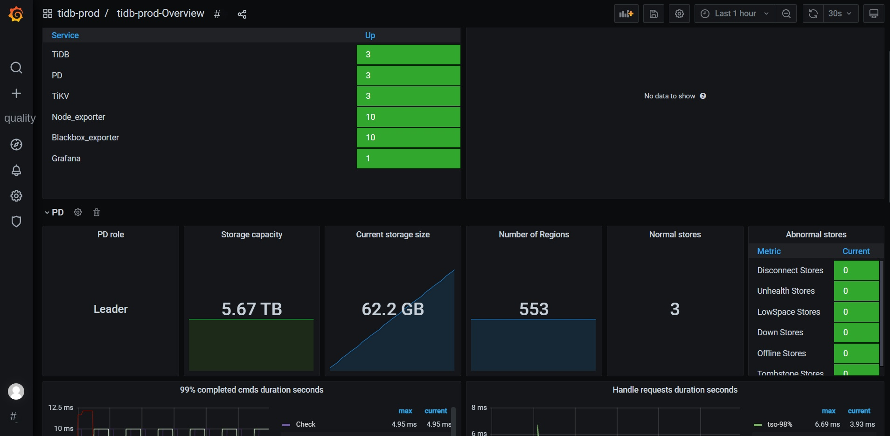

6. Click the **Resources** tab and find the instance whose instance name is **ControlServer**. Click **Remote Connection in the** Operation **column
**.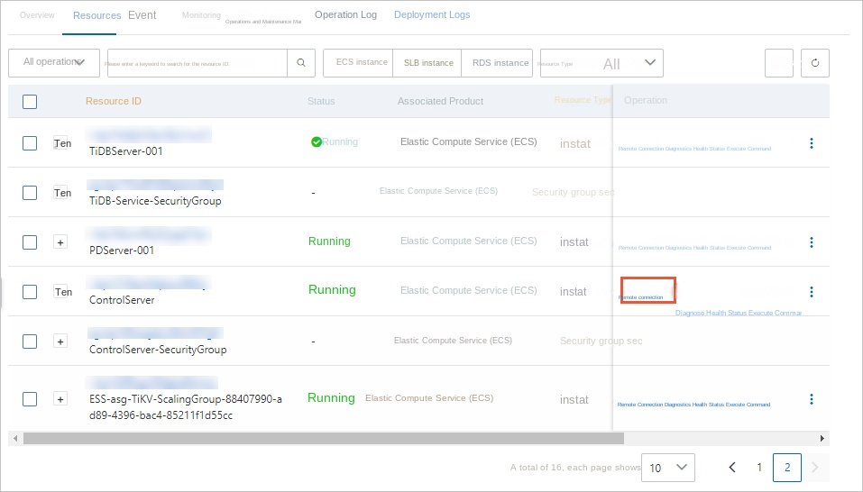

Log on to the TiDB database management console TiUP and view the cluster information after logging on to the console.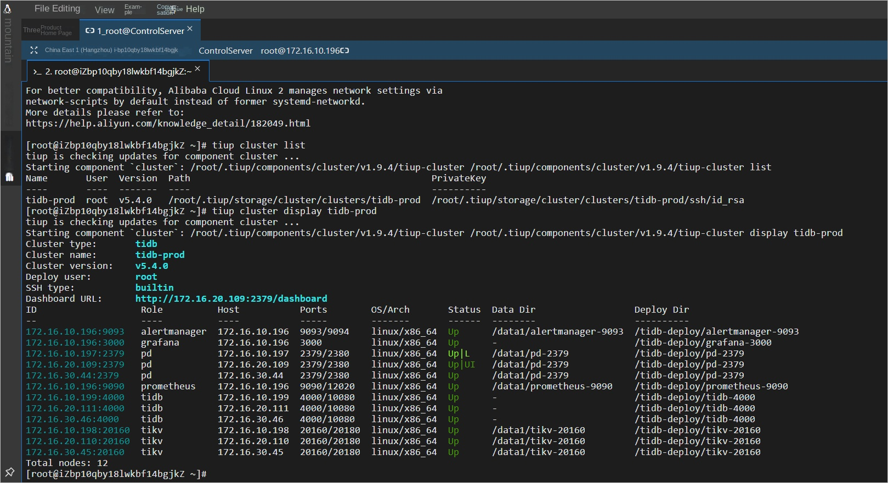

TiDB Cluster Scaling Capacity Management
--------------------------------

If the current traffic and data volume increase or decrease significantly, you can scale the TiDB cluster according to the actual situation.
**Important** To scale in and out, you need to scale the TiDB compute node scaling group and TiKV storage node scaling group separately.

1. Use the Alibaba Cloud account to log on to the [Compute Nest Console](https://computenest.console.aliyun.com/#/vendor/cn-hangzhou/services).

2. In the left-side navigation pane, click **Service Instance Management**.

3. On the **Private Deployment Service** tab page, find the service instance you created.

4. Click the ID of the created service instance to enter the service instance details page.

5. Click **Operations Management**. In the **Application Operations** box, click **Elastic Scaling**.

6. In the Elastic Scaling dialog box, configure the scaling information.

| Configuration Item | Configuration Description |
| --------------- | ------------------------- |
| Scaling Group ID | Select the name of the scaling group to be scaled. |
| Adjustment Method of Scaling Rule | Scale out, scale in, or adjust to a specified quantity according to the plan. |
| Number of ECS instances in the scaling group to be adjusted | Enter the number of instances to be adjusted. |
| RAM role played by OOS | Select the permission for scaling operations. By default, the existing permissions of the current account are used. |
| Task Description | The description of the scaling operation. |

7. Click **Create**.

After the creation is complete, you can view the scaling progress on the **Operations Management** tab page.
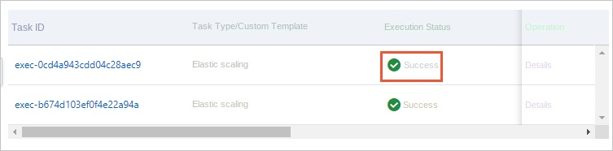

After the scaling group is scaled, you can view the scaling information through Tiup in the iDB cluster management console.
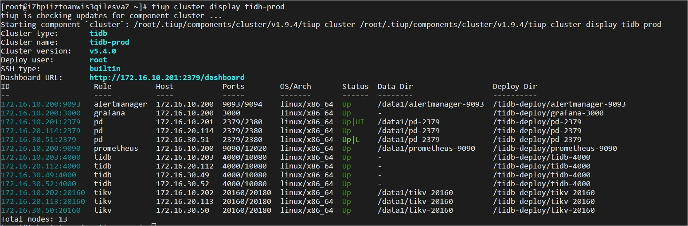

